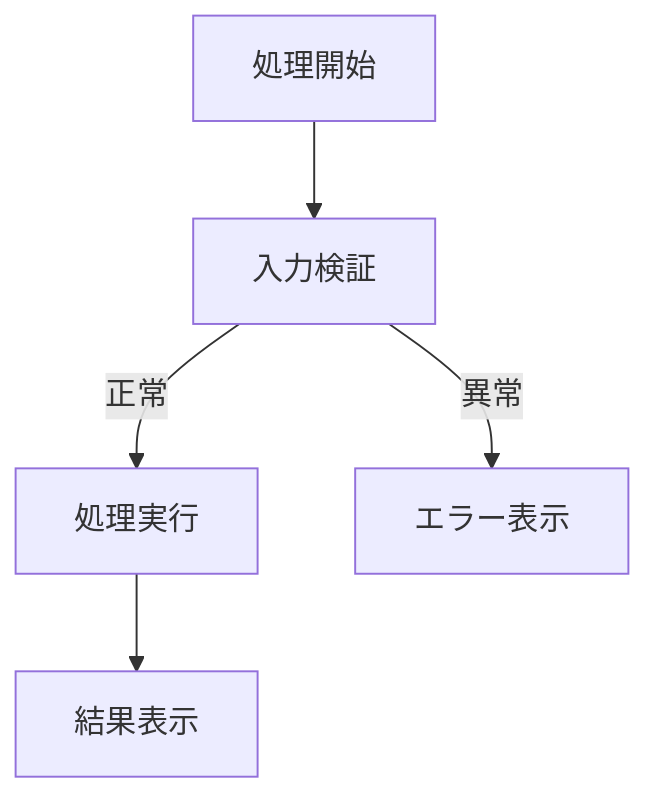
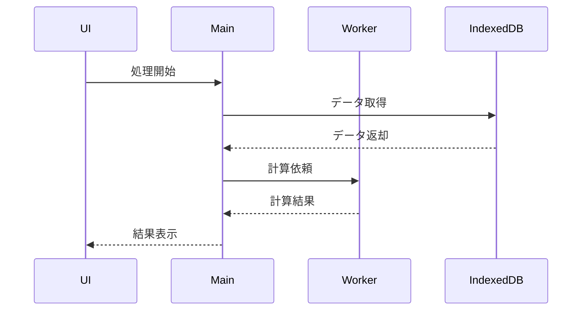
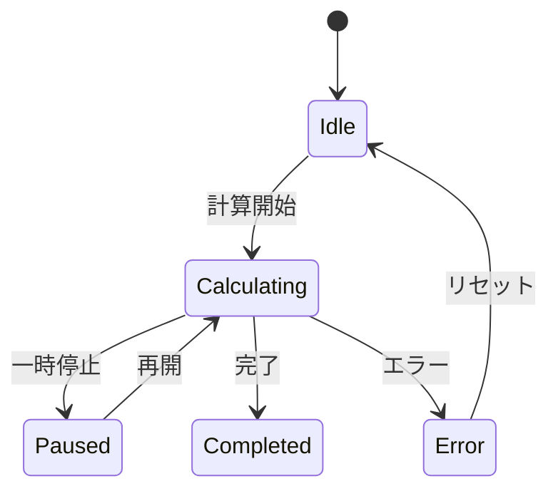
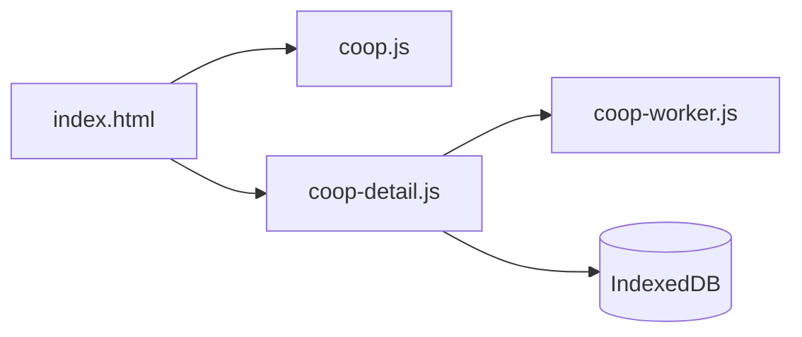
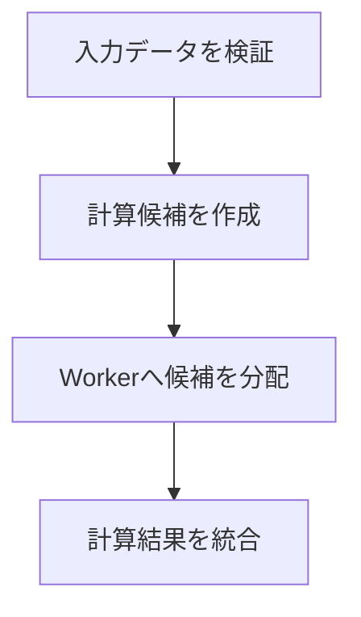
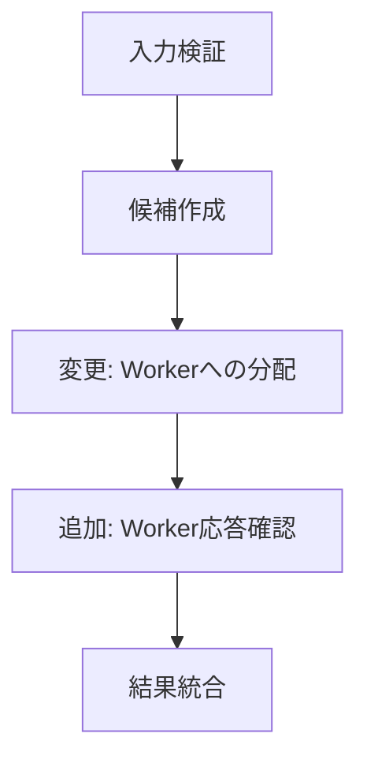
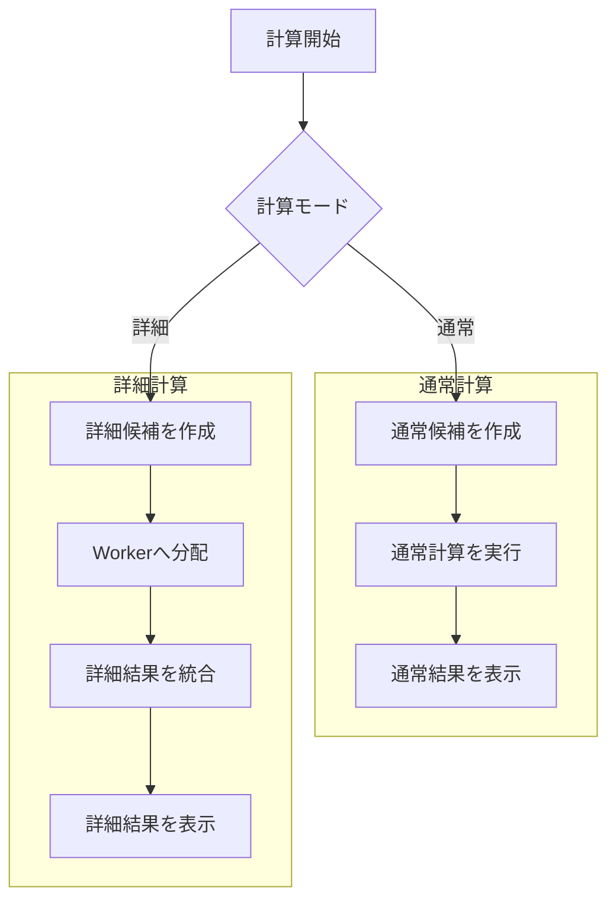
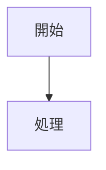
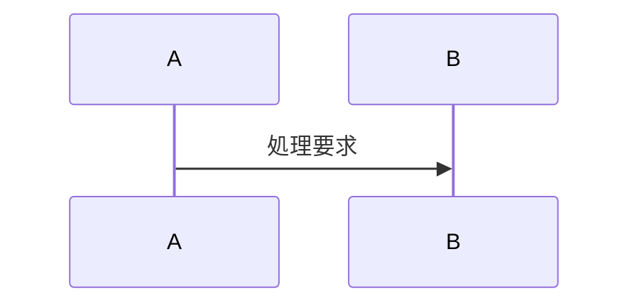

# AIツール開発用「処理設計・フロー共有」指示書

## 1. 基本方針

今後、このツールの処理構造、動作手順、データの流れ、状態遷移、モジュール間通信を説明・提案・変更するときは、以下の形式を使用してください。

設計内容は、画像としてではなく、AIと人間の双方が編集・比較できるテキスト形式で記述してください。

原則として、次の組み合わせを使用してください。

1. Mermaid形式の図
2. ノードごとの補足仕様
3. 変更範囲
4. 変更禁止範囲
5. 維持すべき既存動作
6. 未確定事項または仮定

画像生成によるフローチャートは使用しないでください。

図だけで仕様を確定せず、図から読み取れない条件、入出力、例外処理、状態変更については、必ず文章または構造化データで補足してください。

---

## 2. 図の使い分け

内容に応じて、以下の図を使用してください。

### A. 処理全体の流れ

処理順、条件分岐、開始から終了までの流れには、Mermaidの `flowchart` を使用してください。



### B. ファイル、Worker、DB、UI間の通信

複数のファイル、Web Worker、IndexedDB、UIなどの間で行われる通信には、Mermaidの `sequenceDiagram` を使用してください。



### C. 状態の変化

待機中、計算中、一時停止中、完了、エラーなどの状態変化には、Mermaidの `stateDiagram-v2` を使用してください。



### D. ファイル・モジュールの依存関係

ファイル間の呼び出しや依存関係には、簡潔な `flowchart LR` を使用してください。



### E. 複雑な条件分岐

条件の組み合わせによって処理が変わる場合は、図だけではなく、決定表も使用してください。

| 条件 | 通常計算 | 詳細計算 | 動作 |
|---|---:|---:|---|
| 入力正常 | 有効 | 無効 | 通常計算を実行 |
| 入力正常 | 無効 | 有効 | 詳細計算を実行 |
| 入力異常 | 任意 | 任意 | 計算せずエラー表示 |
| Worker失敗 | 無効 | 有効 | 指定されたエラー処理を実行 |

---

## 3. ノードIDのルール

Mermaid図の各処理には、必ず固定のノードIDを付けてください。

ノードIDは、表示名とは別に管理してください。



変更指示では、「右側の処理」「下の箱」などの位置表現を使用せず、必ずノードIDを使ってください。

良い例：

- C03のみ変更する
- C02からC04までの接続を変更する
- C01の入力条件は変更しない

悪い例：

- 右側の箱を変更する
- 真ん中あたりの処理を修正する
- 下の流れを適当に改善する

既存ノードの意味を変更する場合は、同じIDを流用せず、変更理由を説明してください。

---

## 4. ノード補足仕様

フローチャートの後に、主要ノードの仕様をYAML形式で記述してください。

```yaml
nodes:
  C01:
    name: 入力データを検証
    responsibility:
      - 必須項目を確認する
      - 数値範囲を確認する
    file:
      - coop.js
    input:
      - deckData
      - calculationSettings
    output:
      - validatedData
    state_changes:
      - なし
    errors:
      - 必須項目が不足している
      - 数値が許容範囲外
    must_preserve:
      - 既存の入力判定条件
      - 既存のエラー表示内容

  C03:
    name: Workerへ候補を分配
    responsibility:
      - 候補をWorkerごとに分割する
      - Workerへ計算データを送信する
    file:
      - coop-detail.js
    input:
      - candidateList
      - workerCount
    output:
      - workerJobs
    state_changes:
      - 計算状態を実行中に変更する
    errors:
      - Workerの起動失敗
      - Workerからの応答停止
    must_preserve:
      - 候補の並び順
      - 計算結果
      - 通常計算の処理
```

不明な項目は推測で確定せず、次のように明示してください。

```yaml
unknown:
  - Worker停止時に再試行するかは未確定
  - 途中結果を保存するかは未確定
```

---

## 5. 変更提案時の必須構成

コード変更を提案するときは、必ず以下の順番で回答してください。

### 1. 変更目的

何を改善または修正するのかを簡潔に記述してください。

### 2. 現在の処理

変更前の処理をMermaid形式で示してください。

### 3. 変更後の処理

変更後の処理をMermaid形式で示してください。

変更したノードには、表示名の先頭に `変更` または `追加` を付けてください。



### 4. 差分一覧

変更前と変更後の差を、ノードID単位で記述してください。

```text
変更:
- C03: 候補分割方式を変更
- C03: 送信バッチサイズを変更

追加:
- C05: Worker応答確認処理を追加

削除:
- なし

変更しない:
- C01: 入力検証
- C02: 候補作成
- C04: 結果統合
```

### 5. 対象ファイル

変更するファイルだけを列挙してください。

```text
変更対象:
- coop-detail.js
- coop-worker.js
```

変更しないファイルも明示してください。

```text
変更対象外:
- coop.js
- index.html
- style.css
```

### 6. 維持すべき既存動作

変更によって影響を受けてはいけない動作を列挙してください。

```text
維持する動作:
- 通常計算の計算結果
- 通常計算の候補選択
- 候補の表示順
- 詳細計算以外のUI
- 既存の保存データ形式
```

### 7. リスクと確認項目

変更によって起こり得る問題と、確認すべき項目を記述してください。

```text
リスク:
- Worker数によって結果順が変わる可能性
- 非同期処理の完了順が表示順に影響する可能性
- 大きなバッチでメモリ使用量が増える可能性

確認項目:
- Worker数を変えても計算結果が一致するか
- 通常計算が変更前と一致するか
- 中断後に状態が正しく戻るか
```

---

## 6. 既存動作を保護するルール

明示的な指示がない限り、既存の正常動作を変更しないでください。

特に次の変更を勝手に行わないでください。

- 通常計算のロジック変更
- 計算対象範囲の拡大または縮小
- 候補の選択条件変更
- 候補や結果の並び順変更
- 詳細計算の結果を通常計算へ混入
- UI構成の変更
- ボタン名や表示文言の変更
- ファイル名や関数名の変更
- 保存データ構造の変更
- 既存処理の削除
- 指示されていないリファクタリング
- 指示されていない最適化

変更が必要に見える場合でも、対象外の処理は変更案から分離してください。

「より良い設計だから」という理由だけで、変更範囲を拡大しないでください。

---

## 7. 不変条件

変更前に、今回の変更で維持する不変条件を明示してください。

例：

```yaml
invariants:
  - 通常計算の入力と出力は変更前と一致する
  - Worker数によって最終結果が変化しない
  - 並列処理の完了順によって表示順が変化しない
  - 詳細計算の変更は通常計算へ影響しない
  - エラー発生時は途中結果を完了結果として扱わない
  - 同じ入力からは同じ結果が得られる
```

実装後の説明でも、この不変条件がどのように保護されているか確認してください。

---

## 8. 通常フローと詳細フローの分離

通常処理と詳細処理が存在する場合は、一つの経路として混在させず、図上で明確に分離してください。



通常処理のノードは `N`、詳細処理のノードは `D` から始めてください。

共通処理を設ける場合は `C` を使用し、どちらの処理から呼ばれるか明示してください。

---

## 9. 図の複雑化を防ぐルール

1つの図にすべての処理を詰め込まないでください。

以下の場合は図を分割してください。

- ノード数が多く、全体を一目で追えない
- 通常処理と詳細処理が混在している
- UI、Worker、DB通信が同じ図に入り複雑になっている
- エラー処理が本来の処理を見えにくくしている
- 1つのノード内に複数の責務がある

推奨する分割単位：

1. 全体フロー
2. 通常計算フロー
3. 詳細計算フロー
4. Worker通信
5. IndexedDBアクセス
6. エラー・中断・再開処理
7. 結果統合・表示処理

全体図では概要だけを示し、詳細は別図にしてください。

---

## 10. 実装コードとの対応

図中の処理が実装済みの場合は、可能な範囲で次の情報を対応付けてください。

```yaml
implementation_map:
  D01:
    file: coop-detail.js
    function:
      - createDetailCandidates

  D02:
    file: coop-detail.js
    function:
      - dispatchWorkerJobs

  D03:
    file:
      - coop-detail.js
      - coop-worker.js
    function:
      - mergeWorkerResults
```

実際のコードを確認していない場合は、関数名を推測で作らないでください。

その場合は次のように記述してください。

```yaml
implementation_map:
  D02:
    file: coop-detail.js
    function: 未確認
```

---

## 11. AIが図を作成するときの禁止事項

以下は禁止します。

- 画像だけでフローを提示する
- Mermaid図だけで仕様説明を終える
- ノードIDを付けずに図を作る
- 現在の仕様と提案仕様を混在させる
- 現在のコードを確認せずに関数名を断定する
- 不明な動作を推測で確定する
- 変更対象外の処理まで改善する
- 通常計算と詳細計算を同じ処理として扱う
- 並列処理の完了順と結果表示順を同一視する
- エラー経路を省略する
- UI表示だけを見て内部状態を推測する
- 「必要に応じて処理する」などの曖昧な表現を使う

曖昧な処理は、条件と結果を具体的に分解してください。

悪い例：

```text
必要に応じて結果を調整する
```

良い例：

```text
Workerから全ジョブの完了通知を受け取った場合のみ、
jobIndex順に結果を並べ替えて最終結果を確定する。
```

---

## 12. 標準出力テンプレート

以後、設計や処理フローを提示するときは、原則として次の形式で回答してください。

### 設計名

#### 目的

この設計で実現または変更する内容。

#### 対象範囲

- 対象処理
- 対象ファイル

#### 対象外

- 変更しない処理
- 変更しないファイル
- 維持するUI

#### 全体フロー



#### 通信フロー

必要な場合のみ記載します。



#### ノード仕様

```yaml
nodes:
  A:
    name: 開始
```

#### 変更差分

```text
追加:
- ...

変更:
- ...

削除:
- ...

変更しない:
- ...
```

#### 不変条件

```yaml
invariants:
  - ...
```

#### エラー処理

- 発生条件
- 処理内容
- 表示内容
- 状態の戻し先
- 途中結果の扱い

#### 対象ファイル

```text
変更:
- ...

変更なし:
- ...
```

#### リスク

- 想定される影響
- 競合や順序の問題
- メモリや速度への影響

#### 確認項目

- 正常系
- 異常系
- 境界値
- 通常処理への非影響確認
- Worker数やバッチサイズを変えた場合の結果一致

#### 未確定事項

- 未確認の仕様
- コード確認が必要な箇所
- 仮定している箇所

---

## 13. 最終ルール

図は説明を見やすくするために使用し、図だけを仕様として扱わないでください。

仕様の正確性は、次の組み合わせで確保してください。

- Mermaid図：処理の流れを表す
- YAML：ノードの責務と入出力を表す
- 決定表：複雑な条件を表す
- 不変条件：変更してはいけない動作を表す
- 差分一覧：今回の変更範囲を表す
- 対象ファイル一覧：実際の修正範囲を表す

既存コードが提供されている場合は、先にコードを確認し、実際の処理に基づいて図を作成してください。

コードと図が一致しない場合は、勝手にどちらかへ合わせず、以下を分けて提示してください。

1. 現在コード上で行われている処理
2. 既存資料に記載されている処理
3. 今回提案する処理
4. それぞれの相違点

以上のルールに従い、以後の処理設計と変更提案を提示してください。
